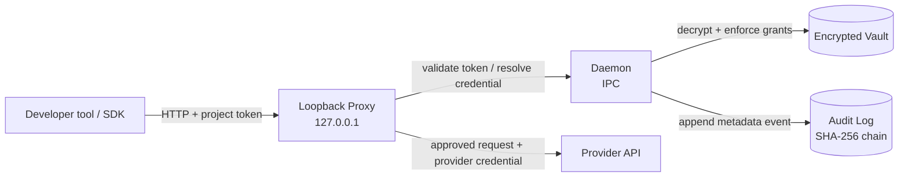

<p align="center">
  
</p>

# Keyless

**Give your AI the keys. Never give it the secrets.**

<p align="center">
  
</p>

Keyless is a local-first credential gateway for AI-assisted development. Provider credentials stay in an encrypted vault. A local proxy validates a scoped project token, asks the daemon to resolve the approved credential, removes caller-supplied authentication, and injects the provider credential before forwarding the request.

Keyless is designed to reduce accidental secret exposure in source files, agent configuration and routine request flows. It is not a security sandbox.

> **Important threat-model limit:** arbitrary code running as the same operating-system user may be able to read project tokens, call the local proxy, inspect accessible files, or inspect process memory. Keyless does not protect against malicious same-user code, administrator/root access, or a compromised machine.

## Status

Keyless is an early `0.1.0` release candidate. The Vault, daemon IPC, project-token/grant validation, local HTTP proxy, CLI grant flow and metadata-only audit log are implemented and have passed the project owner's reported local test suite (53 tests) and end-to-end test. 

The current implementation is intentionally narrower than the full design documents in some areas:

- Interactive grant approval is a terminal `yes` confirmation. It is **not** backed by macOS LocalAuthentication, Windows Hello or polkit, and the approval hash is not a daemon-issued one-time challenge.
- The audit log uses a SHA-256 chain and a local checkpoint file. This detects modification/deletion of the log when the checkpoint remains intact; it is not tamper-proof against an attacker who can rewrite both files.
- The proxy currently supports the built-in OpenAI and Anthropic aliases. Review the source and grant constraints before using it with sensitive workloads.
- Windows named-pipe behavior and Windows file permissions have not been validated; Windows support is untested.
- An external security review is still recommended before production use.

## Requirements

- Node.js **22.14.0 or newer**.
- macOS/Linux is the tested target. Windows is currently untested.
- A provider API credential for each provider alias you intend to use.

## Installation

After the package is published to npm:

```bash
npm install -g keyless
```

Then verify:

```bash
keyless
```

For development from a checkout:

```bash
git clone https://github.com/ace76ah/keyless.git
cd keyless
npm install
npm link
```

If the npm package name is unavailable or the package has not yet been published, install from the repository checkout using the development instructions above.

## Quickstart

The examples use OpenAI. Keep your real provider key out of project files and agent prompts.

### 1. Create the encrypted vault

```bash
keyless init
```

Enter a strong vault passphrase at the hidden terminal prompt. The default vault is `~/.keyless/vault.json`.

### 2. Add your provider credential

```bash
keyless add openai --provider openai
```

Paste the provider credential at the hidden prompt. The default alias is `openai`.

### 3. Start the daemon

```bash
keyless daemon start
```

The daemon unlocks the vault and listens on the local IPC endpoint. Keep it running while using the proxy.

### 4. Create an approved project grant

```bash
keyless grant openai \
  --provider openai \
  --methods POST \
  --paths /v1/chat/completions
```

Review the displayed alias, host, methods and paths. Type exactly `yes` to approve. The CLI prints the project token once. Store it outside your repository and do not paste it into an agent conversation.

The current CLI's grant command communicates with the daemon, so start the daemon before running `keyless grant`.

### 5. Start the local proxy

```bash
keyless proxy start --port 8787
```

The proxy binds to `127.0.0.1`. The provider route is path-based:

```text
http://127.0.0.1:8787/c/openai/v1
```

The incoming `Authorization: Bearer <project-token>` is validated locally. The proxy removes caller authentication headers and injects the OpenAI credential resolved from the vault. The project token is not sent to OpenAI.

### 6. Point an SDK or CLI agent at Keyless

For the OpenAI Node SDK, use the project token as the SDK's API key and Keyless as its base URL:

```js
import OpenAI from "openai";

const client = new OpenAI({
  apiKey: process.env.KEYLESS_PROJECT_TOKEN,
  baseURL: "http://127.0.0.1:8787/c/openai/v1",
});
```

For an OpenAI-compatible Aider setup, set the project token as the API key presented to the local proxy:

```bash
export OPENAI_API_BASE="http://127.0.0.1:8787/c/openai/v1"
export OPENAI_API_KEY="$KEYLESS_PROJECT_TOKEN"
aider
```

Do not set `OPENAI_API_KEY` to your real provider secret when routing through Keyless. It should contain the Keyless project token. The daemon injects the actual provider credential.

For Anthropic-compatible clients, use the `/c/anthropic` base URL and configure the Keyless project token in the `Authorization: Bearer` header as supported by that client. SDK-specific header behavior should be tested with the exact SDK version in use.

### 7. Check status, inspect audit events and lock

```bash
keyless daemon status
keyless log
keyless lock
```

`keyless lock` closes the unlocked vault session and stops the daemon. Start the daemon again when you need another session.

## Architecture



- **Vault:** encrypted credential, project-token digest and grant storage.
- **Daemon:** owns the unlocked vault and handles IPC operations.
- **Proxy:** validates project authorization through the daemon, strips caller credentials and forwards to a built-in provider origin.
- **Audit log:** records request metadata, not bodies, headers or secrets.

## Audit and privacy

The audit log is stored at `~/.keyless/audit.log`; its integrity checkpoint is stored alongside it. Logged request fields include timestamp, project ID, alias, method, host, path, status and duration. Request bodies, headers, provider secrets and project-token values must not be recorded.

The local checkpoint is not an external trust anchor. An attacker able to alter both the log and checkpoint can reconstruct the chain. There is no automatic log rotation in this release.

## Development and tests

```bash
npm install
npm test
bash scripts/e2e-test.sh
```

The E2E script uses a mocked upstream and should not make real provider API calls. Do not treat passing tests as a substitute for a security review.

## Documentation

- [Threat model](docs/threat-model.md)
- [Vault format](docs/vault-format.md)
- [Protocol notes](docs/protocol.md)
- [Network rules](docs/network.md)
- [Approval design](docs/approval.md)
- [Open issues](OPEN-ISSUES.md)

## Security reports

Please use GitHub's private vulnerability reporting feature if enabled for this repository. Do not publish unpatched vulnerability details in public issues. General project support: [contact@aahmedhussa.in](mailto:contact@aahmedhussa.in).
