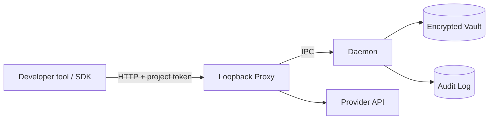

<p align="center">
  
</p>

# Keyless

**Give your AI the keys. Never give it the secrets.**

<p align="center">
  
</p>

Keyless is a local-first credential gateway for AI-assisted development. Provider credentials stay in an encrypted vault. A local proxy validates a scoped project token, asks the daemon to resolve the approved credential, removes caller-supplied authentication, and injects the provider credential before forwarding the request.

Keyless is designed to reduce accidental secret exposure in source files, agent configuration and routine request flows. It is not a security sandbox.

> **Important threat-model limit:** arbitrary code running as the same operating-system user may be able to read project tokens, call the local proxy, inspect accessible files, or inspect process memory. Keyless does not protect against malicious same-user code, administrator/root access, or a compromised machine.

## Status

Keyless is an early `0.1.0` release. The Vault, daemon IPC, project-token/grant validation, local HTTP proxy, CLI grant flow and metadata-only audit log are implemented. Review the threat model and security limitations before production use.

## Requirements

- Node.js **22.14.0 or newer**.
- macOS/Linux are the tested targets. Windows is currently untested.

## Installation

```bash
npm install -g keyless
```

For development from a checkout:

```bash
git clone https://github.com/ace76ah/keyless.git
cd keyless
npm install
npm link
```

## Quickstart

```bash
keyless init
keyless add openai --provider openai
keyless daemon start
keyless grant openai --provider openai --methods POST --paths /v1/chat/completions
keyless proxy start --port 8787
```

Review the grant diff and type exactly `yes`. The CLI prints the project token once. Keep it outside your repository.

Point an OpenAI-compatible SDK at `http://127.0.0.1:8787/c/openai/v1` and provide the Keyless project token as its bearer/API key. Do not use your real provider key in the SDK configuration; the daemon injects the vault-held credential.

Check status and audit history, then lock:

```bash
keyless daemon status
keyless log
keyless lock
```

## Architecture



## Security

See [SECURITY.md](SECURITY.md) and [docs/threat-model.md](docs/threat-model.md). Keyless does not defend against arbitrary code running as the same OS user. Terminal `yes` grant confirmation is not an OS-level approval UI. Windows behavior is untested. The audit hash-chain checkpoint is local and is not an external tamper-proof anchor.

## Development

```bash
npm install
npm test
bash scripts/e2e-test.sh
```

## Contributing

See [CONTRIBUTING.md](CONTRIBUTING.md). All commits must include a Developer Certificate of Origin sign-off (`git commit -s`).

## License

The Keyless core is open-source software licensed under the **GNU Affero General Public License v3.0 (AGPL-3.0)**. See the [LICENSE](LICENSE) file for the complete terms.

Commercial enterprise features, hosted services, support, or separately developed offerings may be offered under separate commercial terms. Those offerings do not change the AGPL rights that apply to the core Keyless code. Any separately licensed feature that is combined with, derived from, or distributed as part of an AGPL-covered work must be assessed for compliance with the AGPL; a separate commercial label does not by itself exempt a combined work from the license.

